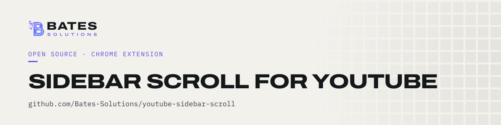

<a href="https://bates-solutions.com/?utm_source=github&utm_medium=readme&utm_campaign=youtube-sidebar-scroll">
  <picture>
    <source media="(prefers-color-scheme: dark)" srcset=".github/assets/readme-banner-dark.svg">
    
  </picture>
</a>

# Sidebar Scroll for YouTube

A Chrome and Firefox extension that scrolls YouTube's recommended videos without scrolling the video out of view.

On a YouTube watch page, the recommendations column gets its own scrollbar, so you can keep
watching while you browse what's next. It is a single stylesheet: no JavaScript and no
permissions beyond access to www.youtube.com.

## Features

- Hover over the recommendations and scroll: only the list moves.
- Hover over the video or comments and scroll: the page scrolls as normal.
- Reaching the end of the list doesn't scroll the page.
- Only applies in the side-by-side layout. Narrow windows are untouched.

## Install

It isn't in the Chrome Web Store or on Firefox Add-ons yet. To install it from source:

1. Download this repo (**Code**, then **Download ZIP**) and unzip it, or `git clone` it.
2. Open `chrome://extensions` and turn on **Developer mode** (top right).
3. Choose **Load unpacked** and select the folder.
4. Refresh any open YouTube tabs.

It works in any Chromium browser: Chrome, Edge, Brave and others.

Chrome may list an "Unrecognized manifest key 'browser_specific_settings'" warning on the
extension's card. That key is for Firefox; the extension works regardless.

In Firefox desktop (140 or later):

1. Open `about:debugging#/runtime/this-firefox`.
2. Choose **Load Temporary Add-on** and select `manifest.json` in the folder.
3. Refresh any open YouTube tabs.

If the sidebar still scrolls with the page, check that the add-on is allowed to run on
www.youtube.com (**Manage Extension**, then **Permissions**): Firefox lets you turn that off.

Firefox removes a temporary add-on when it restarts. To keep it installed before it's on Firefox
Add-ons, sign it for yourself with `npx web-ext sign --channel=unlisted` (it needs a free
Firefox Add-ons API key), or use Firefox Developer Edition or Nightly with
`xpinstall.signatures.required` set to `false` in `about:config`.

## How it works

`styles.css` makes the recommendations column (`#secondary`) sticky, caps its height to the
viewport, and gives it its own scrollbar, with `overscroll-behavior: contain` so reaching the end
of the list doesn't scroll the page.

## Limitations

- If YouTube changes its page structure, the stylesheet may stop matching. Please open an issue if
  it does.

## Privacy

The extension collects, stores and sends no data. It only adds a stylesheet to youtube.com.

## Security

Please report a vulnerability privately, as described in
[SECURITY.md](https://github.com/Bates-Solutions/.github/blob/main/SECURITY.md). Don't open a
public issue for it.

## Contributing

Contributions are welcome. See
[CONTRIBUTING.md](https://github.com/Bates-Solutions/.github/blob/main/CONTRIBUTING.md) and the
[code of conduct](https://github.com/Bates-Solutions/.github/blob/main/CODE_OF_CONDUCT.md).

## License

[MIT](LICENSE). Not affiliated with or endorsed by YouTube or Google.

---

<a href="https://bates-solutions.com/?utm_source=github&utm_medium=readme&utm_campaign=youtube-sidebar-scroll">
  <picture>
    <source media="(prefers-color-scheme: dark)" srcset="https://raw.githubusercontent.com/Bates-Solutions/.github/main/brand/bates-solutions-on-dark.svg">
    
  </picture>
</a>

Made by [Bates Solutions](https://bates-solutions.com/?utm_source=github&utm_medium=readme&utm_campaign=youtube-sidebar-scroll).
